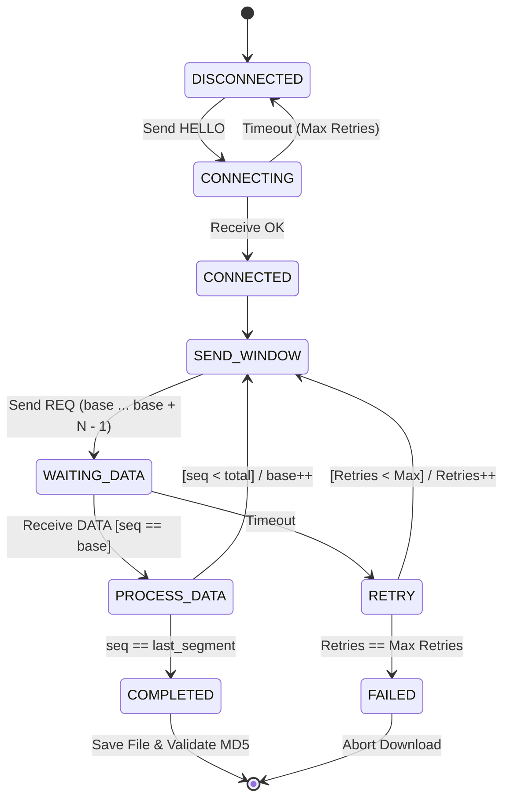
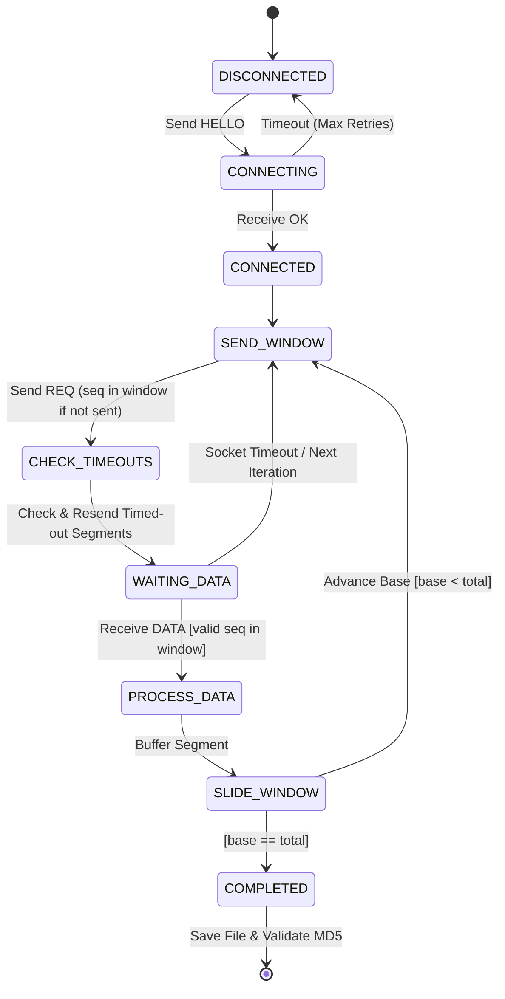

# RDT-UnB Client

Implementação de um cliente de um protocolo Reliable Data Transfer (RDT) para obter um arquivo de um servidor.
Desenvolvido para disciplina de Teleinformática e Redes 2 (2026/2).

## Fluxogramas dos Protocolos

### 1. Go Back N

## 2. Selective Repeat

